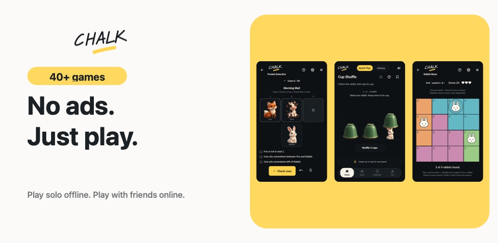
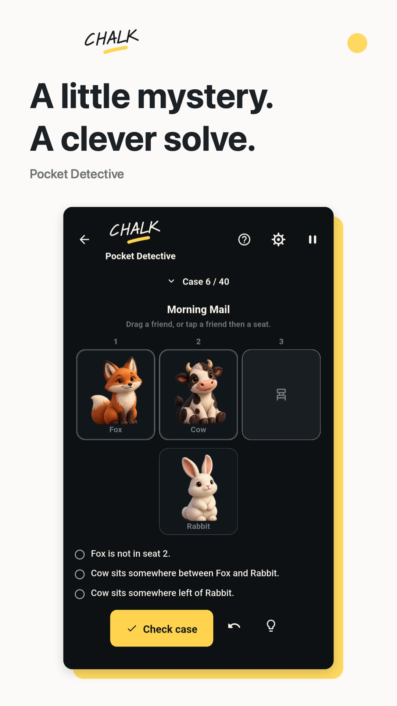
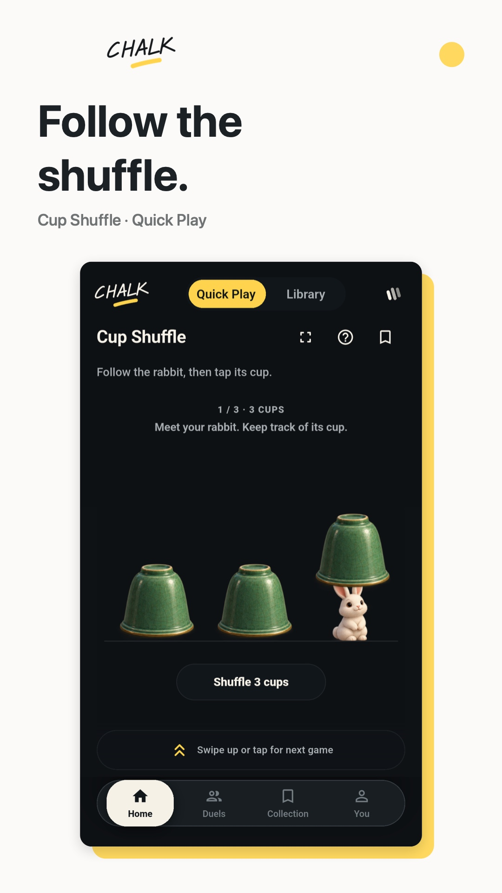
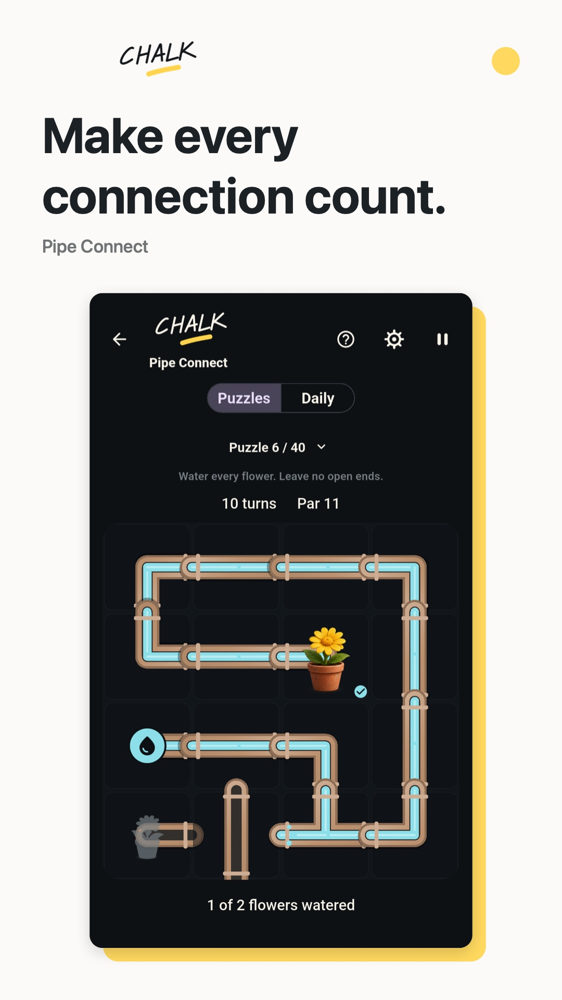

<h1 align="center">Chalk Arcade: Offline Puzzles</h1>

  <strong>40+ games. One little arcade. No ads.</strong> 
  Puzzles, words, brain teasers and board games for your next little break.

  
  &nbsp;
  

  <a href="https://apps.apple.com/app/id6806648338">iPhone &amp; iPad</a> ·
  <a href="https://play.google.com/store/apps/details?id=ch.prab.chalkarcade">Android</a> ·
  <a href="https://chalkarcade.prab.ch/?stay=1">Explore the website</a> ·
  <a href="https://www.youtube.com/watch?v=ILkjiggieT8">Watch the gameplay preview ↗</a>

## A quick challenge. Or a longer escape.

Solve a little mystery, follow the cups, connect the pipes, or settle into a familiar favorite. Chalk Arcade brings a whole shelf of small games together, without ads interrupting the fun.

- **One swipe, a new game.** Quick Play serves bite-sized challenges when you have a minute to spare.
- **Find your favorites.** Explore the Library, from Sudoku and Crossword to Chess and Mini Nonogram. Save games to your Collection.
- **Take a break offline.** Play supported solo games without a connection. Jump in as a guest; an account adds progress sync and online play.
- **Make it a friendly challenge.** Play selected games with friends online, or share a device with local pass-and-play where available.
- **Pick your palette.** Go colorful with Box of Chalk, or keep it simple with Mono Light and Mono Dark.

## A little look inside

  
  &nbsp;
  
  &nbsp;
  

  <strong>Deduce. Remember. Connect.</strong> 
  A few favorites from the arcade. Select an image for a closer look.  
  <a href="https://www.youtube.com/watch?v=ILkjiggieT8">▶ Watch 30 seconds of real gameplay</a>

## Ready for one more game?

Download Chalk Arcade on the **[App Store](https://apps.apple.com/app/id6806648338)** or **[Google Play](https://play.google.com/store/apps/details?id=ch.prab.chalkarcade)**.

Have a question or a game you'd love to see? Visit [Support](https://chalkarcade.prab.ch/support/) or say hello at [chalkarcade@prab.ch](mailto:chalkarcade@prab.ch). If you're enjoying the arcade, a store rating or sharing it with a friend helps others discover it.

---

### About this repository

This is the public website and showcase for Chalk Arcade. The website is deployed at [chalkarcade.prab.ch](https://chalkarcade.prab.ch/?stay=1). See the [developer guide](DEVELOPER.md).

[Website](https://chalkarcade.prab.ch/?stay=1) · [Privacy](https://chalkarcade.prab.ch/privacy/) · [Terms](https://chalkarcade.prab.ch/terms/) · [Account deletion](https://chalkarcade.prab.ch/delete-account/)

Made by [Prabuddha Chakraborty](https://github.com/iam404). © 2026.
